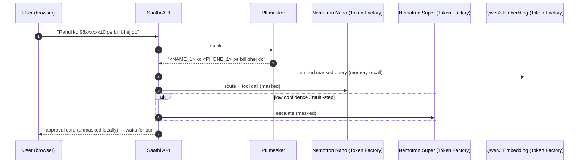
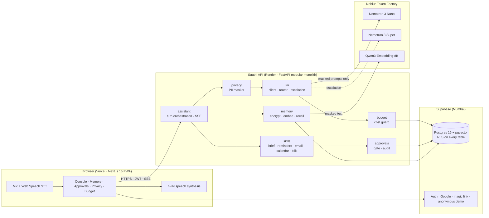

# Saathi — your private Hinglish voice assistant

> Speak in Hindi, English, or Hinglish. Saathi remembers only what you allow, runs everyday tasks, masks your personal data before any model sees it, and never sends, books, or pays without your tap.

**Live demo:** [saathi-chi-sandy.vercel.app](https://saathi-chi-sandy.vercel.app) (no sign-up: open it and you get a demo session; the free API can take up to a minute to wake on the first visit) · **Demo video:** [youtube.com/watch?v=11ExLjcqi3E](https://www.youtube.com/watch?v=11ExLjcqi3E) · **Devpost:** [devpost.com/software/saathi-private-hinglish-voice-assistant](https://devpost.com/software/saathi-private-hinglish-voice-assistant)

[](LICENSE)

---

## Why Saathi

Hundreds of millions of Indians think and talk in a mix of Hindi and English, yet most assistants either miss Hinglish or ask you to hand over your phone number, Aadhaar, PAN, and UPI ID to a cloud model. Saathi is built the other way around:

- **Hinglish first.** "Kal subah 9 baje mummy ko call karna yaad dilana" just works.
- **Private by design.** Personal identifiers are swapped for tokens like `<PHONE_1>` *before* any model call and swapped back only on our side.
- **You stay in control.** Anything with a side effect becomes an approval card. Nothing happens until you tap.

## How Saathi uses NVIDIA Nemotron on Nebius Token Factory

Every model call goes to **Nebius Token Factory** through its OpenAI-compatible API (`https://api.tokenfactory.nebius.com/v1`).

| Role | Model (Token Factory ID) | When it is called |
|---|---|---|
| Fast router | **NVIDIA Nemotron 3 Nano** — `nvidia/NVIDIA-Nemotron-3-Nano-30B-A3B` | Every turn: intent classification, skill/tool selection as JSON tool calls, short replies, memory-fact proposals |
| Reasoning | **NVIDIA Nemotron 3 Super** — `nvidia/nemotron-3-super-120b-a12b` | Escalation only: multi-step or ambiguous asks, low router confidence, or a failed tool call |
| Embeddings | **Qwen3-Embedding-8B** — `Qwen/Qwen3-Embedding-8B` (truncated to 1024 dims) | Memory write + semantic recall over pgvector |

Calls per voice turn, typically: **1 × Nano** (route + answer), **+1 × Super** only on escalation, **+1 × embedding** when memory is read or written. A budget guard prices every call (tokens × list price) and enforces per-user and global daily caps.



## Features

- 🎙️ **Voice console** — browser speech recognition (hi-IN / en-IN) with streamed replies (SSE) and spoken answers.
- 🧠 **Memory you control** — Saathi proposes facts; you view, edit, or delete them. Encrypted at rest (AES-256-GCM).
- ✅ **Approval gate** — send / book / pay actions become cards with the exact content or amount; idempotent approve/reject; full audit trail.
- 🛡️ **Privacy dashboard** — see exactly what the model saw for each request ("model saw: `<PHONE_1>`").
- 💸 **Budget meter** — spend today, per-model breakdown, hard caps.
- 🧩 **Skills** — daily brief, reminders, email triage, calendar, bill tracking (demo data in the hosted build).

## Privacy design

1. **Mask before model.** Phone, email, Aadhaar, PAN, UPI ID, card/account numbers, IFSC, and names from memory are replaced with reversible tokens; the token map never leaves the API.
2. **Encrypt at rest.** Memory, reminders, and pending-action payloads are AES-256-GCM encrypted with a per-user key (HKDF from a server pepper + user id, versioned for rotation).
3. **Row Level Security** on every table (`user_id = auth.uid()`); audit log is append-only.
4. **Counts, not content.** Privacy events store how many entities were masked, never the raw values.
5. **No real side effects in the demo.** Actions run on demo data and still pass through the approval gate.

Details and the honest trade-offs (including what embeddings can leak): [SECURITY.md](SECURITY.md).

## Architecture



The backend is a **modular monolith**: one deployable service, internally split into feature modules (`router → service → repository`), each owning its own tables. See [ADR 0001](docs/adr/0001-modular-monolith.md).

## Tech stack

| Layer | Choice |
|---|---|
| Web | Next.js 15 (App Router, RSC), TypeScript strict, Tailwind v4, shadcn/ui, TanStack Query, built-in Hindi/English dictionaries, Serwist PWA |
| API | Python 3.12, FastAPI, Pydantic v2, async SQLAlchemy 2 + asyncpg, Alembic, structlog, tenacity, slowapi |
| Data | Supabase Postgres 16 + pgvector (HNSW), Supabase Auth |
| LLM | Nebius Token Factory: Nemotron 3 Nano, Nemotron 3 Super, Qwen3-Embedding-8B |
| Voice | Browser Web Speech API (hi-IN / en-IN) + speech synthesis; faster-whisper and VoxCPM2 for local / offline experiments |
| Ops | Docker, Render (Singapore), Vercel, Sentry |

## Quick start

Prereqs: Docker (Compose v2.24+), [uv](https://docs.astral.sh/uv/), Node 22 with corepack (pnpm).

```bash
git clone https://github.com/sandeepguptax2003/saathi.git && cd saathi
make setup     # installs deps, git hooks, copies apps/*/.env.example -> .env
make dev       # Postgres+pgvector, API (hot reload) on :8000, web on :3000
# in a second terminal
make migrate   # alembic upgrade head + RLS policies
make seed      # demo inbox / calendar / bills
```

Open http://localhost:3000. API docs: http://localhost:8000/docs.

## Environment setup

Each app owns its template; the root [`.env.example`](.env.example) only holds local port overrides.

| File | Key variables |
|---|---|
| [`apps/api/.env.example`](apps/api/.env.example) | `NEBIUS_API_KEY`, `NEBIUS_BASE_URL`, `MODEL_FAST`, `MODEL_REASONING`, `MODEL_EMBED`, `DATABASE_URL`, `SUPABASE_URL`, `SUPABASE_JWT_SECRET`, `ENCRYPTION_PEPPER`, `DAILY_BUDGET_USD`, `CORS_ORIGINS`, `SENTRY_DSN`, `LOG_LEVEL`, `ENV` |
| [`apps/web/.env.example`](apps/web/.env.example) | `NEXT_PUBLIC_API_URL`, `NEXT_PUBLIC_SUPABASE_URL`, `NEXT_PUBLIC_SUPABASE_ANON_KEY`, `NEXT_PUBLIC_SENTRY_DSN` |

Get a Token Factory key at [tokenfactory.nebius.com](https://tokenfactory.nebius.com). Config is validated at boot; the apps refuse to start on missing variables.

## Tests

```bash
make test        # pytest (API) + vitest (web)
make lint        # ruff, mypy --strict, eslint, prettier, tsc, gitleaks
make e2e         # Playwright against the running stack (LLM mocked)
```

Run these checks locally before pushing.

## Deployment

| Piece | Where | How |
|---|---|---|
| Web | Vercel Hobby | Git integration: production deploy on every push to `main` (other branches are skipped) |
| API | Render free web service (Docker, Singapore) | [`infra/render.yaml`](infra/render.yaml); Render auto-deploys on push to main |
| DB + Auth | Supabase free (ap-south-1) | Alembic migrations + [`infra/supabase/`](infra/supabase) SQL |
| Keep-alive | `keepalive.yml` (every 14 min) | pings `/health` |

## Project structure

```
saathi/
├── apps/
│   ├── api/          # FastAPI modular monolith (src/saathi_api/modules/*)
│   └── web/          # Next.js 15 app
├── infra/            # docker-compose, render.yaml, supabase SQL
├── docs/             # ADRs, demo script
├── .github/          # keepalive workflow, templates
└── Makefile
```

## Roadmap

- [ ] Gmail + Google Calendar connectors (OAuth) beyond demo data
- [ ] Server-side STT (IndicWhisper) for browsers without Hindi speech recognition
- [ ] VoxCPM2 Hindi TTS on a GPU host
- [ ] On-device / browser-side memory encryption (WebCrypto) as an opt-in
- [ ] More Indian languages (Odia, Bengali, Tamil)

## Hackathon note

Built solo by Sandeep Gupta for the **Nebius × NVIDIA Global AI Hackathon** (Personal AI track), October 2026. All runtime model calls go to Nebius Token Factory and use NVIDIA Nemotron open models.

## Feedback on Nebius and NVIDIA tools

- **Token Factory:** the OpenAI-compatible endpoint meant the stock `openai` SDK worked with only a base URL change, and per-model list prices made a real-time budget meter easy. A usage/cost API per key would remove the need to price tokens client-side.
- **Nemotron 3 Nano / Super:** Nano is fast and cheap enough to route every turn, and handles Hinglish well. The reasoning tokens count against `max_tokens`, so a small router budget (256) silently truncated the JSON and every turn fell back to chat; raising it fixed routing. A documented switch to turn reasoning off for strict-JSON calls would help.
- **Docs / onboarding:** a short "JSON mode + reasoning models" note and a Hinglish example in the quick start would save new builders the same debugging.

## License

[Apache-2.0](LICENSE) © 2026 Sandeep Gupta
